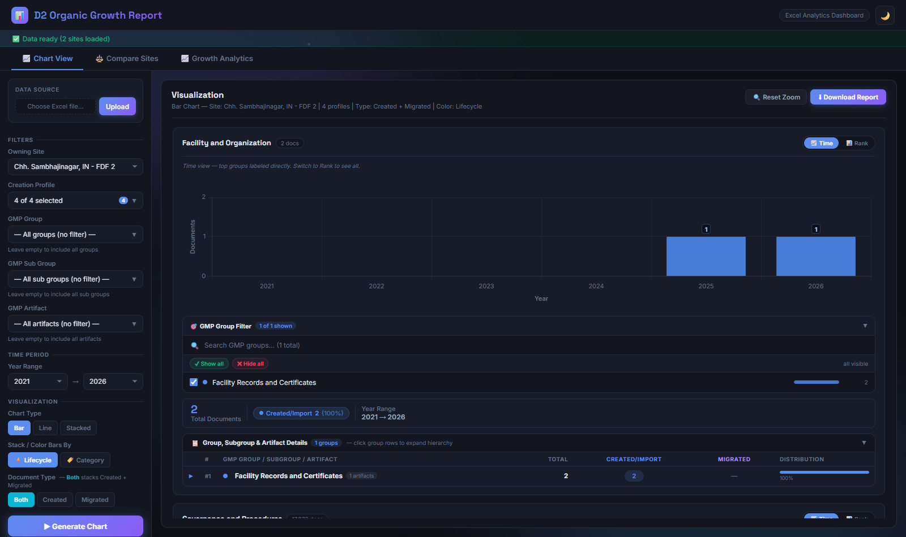

# 📈 Documentum D2 Life Sciences eDMS — Organic Growth Report

A high-performance enterprise analytics and visualization dashboard built for **OpenText Documentum D2 Life Sciences Electronic Document Management Systems (eDMS)**. 

This platform transforms multi-site manufacturing document metadata into actionable executive analytics, multi-year growth trajectories, site comparisons, and audit-ready metrics without external cloud or AI dependencies (**100% deterministic Java & mathematical analysis**).

---

## 📸 Application Screenshots

### 1. 📊 Interactive Chart View & Granular Multi-Filter Exploration
Filter by manufacturing site, creation profiles, and hierarchical GMP groups across operational years (2021–2026).


### 2. ⚖️ Cross-Plant Site Comparison
Benchmark organic document generation velocity across active operating plants (e.g., Nashik vs. Chh. Sambhajinagar).


### 3. 📈 Growth Analytics & Executive Intelligence (5-Year Trajectory & YoY CAGR)
Executive-ready dashboard calculating portfolio baseline, operational expansion, YoY growth curve, and dynamic leadership narratives.


---

## 📐 Mathematical Growth Mechanics & Calculation Methodology

All growth calculations in this application are strictly **deterministic, audit-compliant mathematical formulas** implemented in [`GrowthAnalyticsService.java`](src/main/java/com/example/excelviz/service/GrowthAnalyticsService.java):

### 1. Operational Scope & Divestment Filtering
* To ensure data integrity, only **actively operating manufacturing sites** are included in the multi-year trend calculation.
* Any site designated as divested, decommissioned, or retired is excluded from baseline and portfolio compound trends so historical operational data is not skewed.

### 2. Starting Baseline & Current Volume
* **Baseline Year ($Y_0$):** Earliest active operational year in dataset (e.g. `2021`).
* **Current Year ($Y_n$):** Latest operational year in dataset (e.g. `2026`).
* **Baseline Volume ($V_0$):** $\sum \text{Organic Created Documents in } Y_0$.
* **Current Volume ($V_n$):** $\sum \text{Organic Created Documents in } Y_n$.

### 3. Overall Portfolio Growth Percentage
$$\text{Overall Growth \%} = \left(\frac{V_n - V_0}{V_0}\right) \times 100$$
* *Example:* $\frac{32,138 - 4,491}{4,491} \times 100 = \mathbf{+615.6\%}$

### 4. Year-over-Year (YoY) Growth Rate
For each consecutive operational year $t$:
$$\text{YoY Growth \%}_t = \left(\frac{V_t - V_{t-1}}{V_{t-1}}\right) \times 100$$
* *Yearly Breakdown:*
  * **2021–2022:** $+50.1\%$ YoY ($4,491 \rightarrow 6,739$)
  * **2022–2023:** $-9.4\%$ YoY ($6,739 \rightarrow 6,104$, stabilization phase)
  * **2023–2024:** $+73.0\%$ YoY ($6,104 \rightarrow 10,557$, expansion)
  * **2024–2025:** $+304.3\%$ YoY ($10,557 \rightarrow 42,687$, major D2 plant deployment)
  * **2025–2026:** $-24.7\%$ YoY ($42,687 \rightarrow 32,138$, operational steady state)

### 5. Dynamic Compound Annual Growth Rate ($n$-Year CAGR)
$$\text{CAGR} = \left[\left(\frac{V_n}{V_0}\right)^{\frac{1}{n}} - 1\right] \times 100$$
where $n = Y_n - Y_0$ is dynamically determined from the uploaded dataset (e.g. 5-Year CAGR for 2021–2026, 10-Year CAGR for 10-year datasets). The **Active Site Growth Overview** matrix dynamically binds its header and calculations to the exact year span.
In addition, the **Document Volume Trajectory & Growth Curve** features dual-axis and node tracking with **Yearly CAGR (%)** dynamically plotted for each year along the operational timeline.

---

## 🏛️ System Architecture

* **Backend:** Java 17, Spring Boot 3.2.5, Apache POI (Streaming OpenXML & HSSF).
* **Frontend:** Responsive vanilla HTML5, CSS3 Glassmorphism tokens, Chart.js 4.4.
* **Testing:** JUnit 5, Spring Boot Test, MockMvc (100% test pass rate).
* **Privacy & Security:** Strictly in-memory parsing; `.gitignore` configured to ensure no sensitive raw Excel files are tracked.

---

## 🚀 Getting Started

### Prerequisites
* Java JDK 17+
* Maven 3.8+ (or included `./mvnw`)

### Running Locally
```bash
# Clone the repository
git clone https://github.com/manojvenaram/D2_organic_growth_report.git
cd D2_organic_growth_report

# Run tests
./mvnw test

# Start the application
./mvnw spring-boot:run
```

Once started, open your browser at:
```
http://localhost:8081
```

1. Click **Choose Excel file...** on the left sidebar and upload your Documentum D2 metadata workbook.
2. Navigate between **📈 Chart View**, **⚖️ Compare Sites**, and **📈 Growth Analytics**.

---

## 🛡️ Regulatory & Compliance Note
All document categorizations follow standard Life Sciences GMP classifications (SOPs, Forms, Master Manufacturing, Specifications, Protocols, and Method lifecycles).
